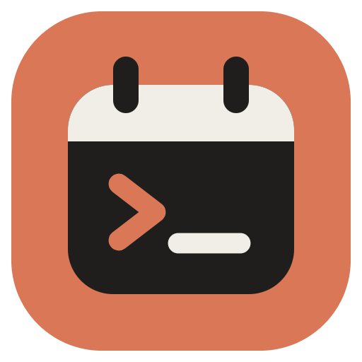
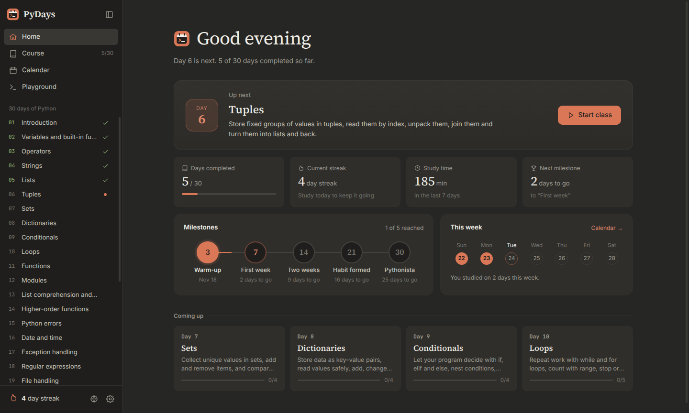
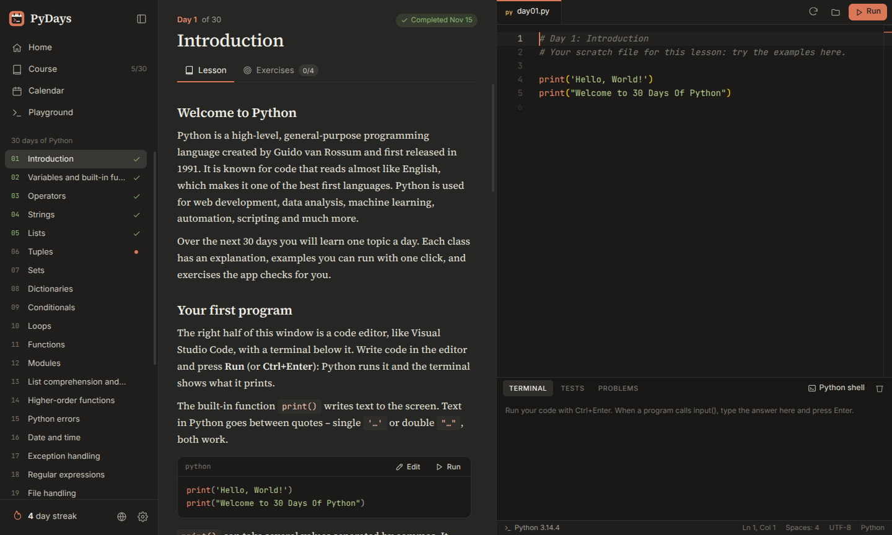
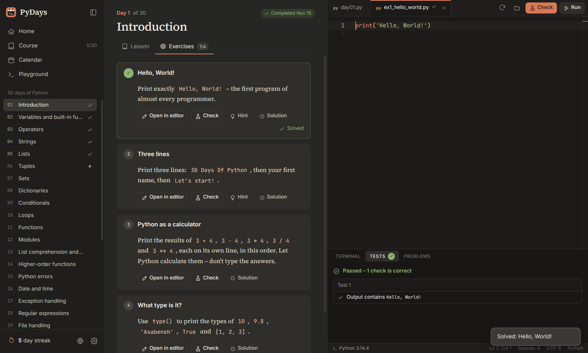
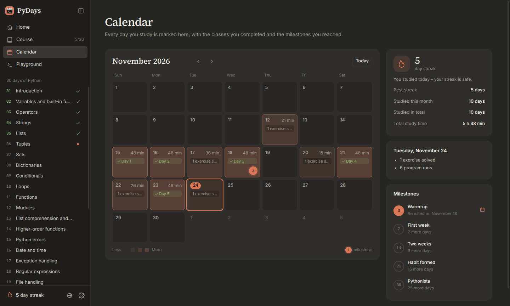

<p align="center">
  
</p>

<h1 align="center">PyDays</h1>

<p align="center">
  <b>Learn Python in 30 days: one class a day, a VS Code-style editor, a real terminal and a calendar that tracks your progress.</b>
</p>

<p align="center">
  <a href="https://github.com/nokkiee/pydays/releases/latest"></a>
  <a href="https://github.com/nokkiee/pydays/blob/main/LICENSE"></a>
  <a href="#requirements"></a>
  <a href="#requirements"></a>
  <a href="https://github.com/nokkiee/pydays/releases/latest"></a>
  <a href="#languages"></a>
  <a href="https://github.com/nokkiee/pydays/commits/main"></a>
  <a href="https://github.com/nokkiee/pydays"></a>
  <a href="https://github.com/nokkiee/pydays/actions/workflows/tests.yml"></a>
  <a href="https://github.com/nokkiee/pydays/actions/workflows/build.yml"></a>
</p>

<p align="center"><b><a href="https://github.com/nokkiee/pydays/releases/latest">Download</a></b> · <a href="CHANGELOG.md">Changelog</a> · <a href="CONTRIBUTING.md">Contributing</a> · <a href="https://github.com/nokkiee/pydays/issues">Report a bug</a></p>

Each day is one class: read the lesson, run the examples with one click, solve the exercises in the
editor and let the app check them. Everything runs on your own computer with your own Python, and
nothing is sent anywhere. The app is available in English, Polish, German, Spanish and French.

The course follows the day-by-day curriculum of [30 Days Of Python](https://github.com/Asabeneh/30-Days-Of-Python)
by Asabeneh Yetayeh. The lessons and exercises in this app are original writing for the app and
follow that curriculum. Each lesson links to its day in the original course.



## What is inside

- **30 classes.** Each day has a lesson with runnable examples and 3–5 exercises with automatic
  checks. The days run from *Introduction* to *Building an API* and *Conclusions* (see the table below).
- **Editor.** Monaco, the editor from VS Code, with a dark theme, Python completions, and a
  Problems panel that marks syntax errors as you type.
- **Terminal.** Programs run in your own Python. `input()` is answered in the terminal, and
  tracebacks are marked on the matching line in the editor. There is also an interactive Python shell.
- **Exercise checks.** Each check runs your program and reports which test passed or failed.
  Hints and a model solution are available when you get stuck.
- **Calendar.** Every day you study is marked, with your study time, solved exercises and finished
  lessons. It shows your streak, your longest streak and your total study time.
- **Milestones** at 3, 7, 14, 21 and 30 completed days, celebrated in the app and shown in the
  calendar on the day you reach them.
- **Sandbox.** A free editor for your own experiments.
- **Warm, slim dark design,** with a serif for reading and a monospace font for code.
- **Languages.** The interface and all 30 lessons exist in five languages. You can switch at any time.

### Lessons



- Explanations are short and written for beginners, with examples you can **run** or **edit** in
  place. Lessons about files show the data file next to the example, and it is written next to
  your program, so the example just works.
- Examples that need a server, a database or an extra package are shown but not run, and the
  terminal tells you which `pip install` command to use when a package is missing.

| Day | Topic | Day | Topic |
|---|---|---|---|
| 1 | Introduction | 16 | Date and time |
| 2 | Variables and built-in functions | 17 | Exception handling |
| 3 | Operators | 18 | Regular expressions |
| 4 | Strings | 19 | File handling |
| 5 | Lists | 20 | PIP and packages |
| 6 | Tuples | 21 | Classes and objects |
| 7 | Sets | 22 | Web scraping |
| 8 | Dictionaries | 23 | Virtual environments |
| 9 | Conditionals | 24 | Statistics |
| 10 | Loops | 25 | Pandas |
| 11 | Functions | 26 | Python for the web |
| 12 | Modules | 27 | Python with MongoDB |
| 13 | List comprehension and lambda | 28 | APIs |
| 14 | Higher-order functions | 29 | Building an API |
| 15 | Python errors | 30 | Conclusions |

### Exercises



- Every exercise has a check that runs your code and lists each test as passed or failed.
- **Hint** and **Solution** buttons are there when you are stuck.
- Some exercises open with starter code, for example the data to work with. You can turn this
  off in *Settings → Editor → Starter code*; the app asks once at the first start.
- A day counts as completed when all its exercises pass, or when you mark it done yourself.

### Calendar and milestones



- Each day you study is marked, with the classes you completed and your study time. Time is counted
  only while you work in a lesson or the sandbox with the window focused.
- **Streaks** count consecutive study days. A missed day resets the current streak but never the best one.
- **Milestones** at 3 (*Warm-up*), 7 (*First week*), 14 (*Two weeks*), 21 (*Habit formed*) and
  30 (*Pythonista*) completed days.

### Languages

The interface and every lesson are available in **English, Polski, Deutsch, Español and
Français**. The app asks for your language at the first start and you can change it in
*Settings → Language*. Every text exists in all five languages; this is checked automatically.

## Requirements

- **Windows 10 or 11, or Linux** (any distribution; there is also a .deb for Debian and Ubuntu).
- **Python 3.8 or newer.** The app looks for `python3` or `python`; on Windows it also tries `py -3`.
  You can choose another interpreter, such as a virtual environment, in *Settings → Python*.

| System | Install Python |
|---|---|
| Ubuntu / Debian | `sudo apt install python3` |
| Windows | `winget install Python.Python.3.12` or the installer from [python.org](https://www.python.org/downloads/) |

- **Optional packages for the later days.** The exercises themselves use only the standard library,
  so you only need these to run the lesson examples that use them. If a package is missing, the
  terminal shows the `pip install` command to run.

| Package | Days |
|---|---|
| `requests` | 20, 22, 28 |
| `beautifulsoup4` | 22 |
| `numpy` | 24 |
| `pandas` | 25 |
| `flask` | 26, 29 |
| `pymongo` | 27 |

## Installation

Ready-made files are on the [**Releases**](https://github.com/nokkiee/pydays/releases/latest) page.

| System | File | How |
|---|---|---|
| Windows 10 / 11 | `PyDays-Setup-<version>.exe` | Run it. It installs in a few seconds and adds shortcuts to the Start menu and the desktop. |
| Windows, no install | `PyDays-<version>-Portable.exe` | Just run it. |
| Linux (any distribution) | `PyDays-<version>.AppImage` | Make it executable (`chmod +x`) and run it. |
| Debian / Ubuntu | `pydays_<version>_amd64.deb` | `sudo apt install ./pydays_<version>_amd64.deb` |

The Windows files are not code-signed, so Windows may show *"Windows protected your PC"*. Click
**More info → Run anyway**. Every release has a `SHA256SUMS.txt`; see [SECURITY.md](SECURITY.md)
for how to check a download.

You can also build the packages yourself: `npm run dist` (Linux) and `npm run dist:win` (Windows).

### From source

You need Node.js 20 or newer.

```bash
npm install
```

```bash
npm start
```

To add PyDays to your application menu and dock (no root needed):

```bash
npm run install-desktop
```

## For developers

| Command | What it does |
|---|---|
| `npm start` | runs the app |
| `npm run dev` | runs the app with developer tools (F12) |
| `npm test` | unit tests: content parser, translations, progress and milestones |
| `npm run check-content [day…]` | checks every lesson (see below) |
| `npm run smoke` | starts the app hidden and clicks through lesson, terminal, shell, exercises, calendar and settings |
| `npm run shots -- --lang=pl --seed` | the same, saving screenshots, with a week of sample progress |
| `npm run icons` | renders the app icons from `renderer/img/logo.svg` |
| `npm run social` | draws the repository's social preview (`docs/social-preview.png`) |
| `npm run pack` | builds an unpacked app into `dist/linux-unpacked` |
| `npm run dist` | builds the AppImage and the .deb |
| `npm run dist:win` | builds the Windows installer and the portable version |

`check-content` makes these checks:

- every text exists in all five languages, and tables match between languages;
- every runnable example runs;
- every model solution passes its exercise's tests;
- every starter fails them.

On GitHub (Actions), **Tests** runs the unit tests and `check-content` on Linux and Windows and the
smoke test on Linux. **App build** builds the installer, the portable version, the AppImage and the
.deb, installs the app and checks that the built version starts. When a release is published,
**Checksums** attaches a `SHA256SUMS.txt` with the SHA-256 of every file.

A built package can be checked quickly. This opens the course and a lesson and prints `SELFTEST OK`:

```bash
PYDAYS_SELFTEST=1 dist/linux-unpacked/pydays --no-sandbox
```

### Structure

- `main.js`: Electron main process. Serves the app at `pydays://app/`, stores settings and progress, and handles IPC.
- `src/runner.js` and `src/harness.py`: finding Python, running programs, the interactive shell, and the exercise checks.
- `renderer/`: the interface.
  - `renderer/js/views/`: the screens (home, course, day, calendar, sandbox, settings).
  - `renderer/js/ide.js`, `monaco.js`, `terminal.js`: the editor and the terminal.
  - `renderer/js/parse.js`: the lesson format, described at the top of the file.
  - `renderer/i18n/<language>.js`: the interface texts.
- `content/days/NN.txt`: the lessons and exercises, with every text in five languages.
- `tools/check-content.mjs`: the content checks.
- `scripts/`: the smoke test, icon and social-preview generators, and the desktop launcher.

## Contributing

The version history is in [CHANGELOG.md](CHANGELOG.md). Bug reports and ideas are welcome; the rules
and the setup are in [CONTRIBUTING.md](CONTRIBUTING.md). Please follow the
[code of conduct](CODE_OF_CONDUCT.md), and report security problems as described in
[SECURITY.md](SECURITY.md) (not in public issues).

## Credits and license

- Curriculum: [30 Days Of Python](https://github.com/Asabeneh/30-Days-Of-Python) by Asabeneh Yetayeh. That
  repository has no license, so no text from it is included; all lessons are original.
- Editor: [Monaco Editor](https://github.com/microsoft/monaco-editor) (MIT).
- Markdown: [marked](https://github.com/markedjs/marked) (MIT).
- Fonts: Inter, Source Serif 4 and JetBrains Mono (SIL Open Font License), via Fontsource.
- The Python runner and terminal are adapted from Informatura.

The app is released under the GNU GPL v3 (see [LICENSE](LICENSE)). The other libraries and their
licenses are listed in [THIRD_PARTY_NOTICES.md](THIRD_PARTY_NOTICES.md).
